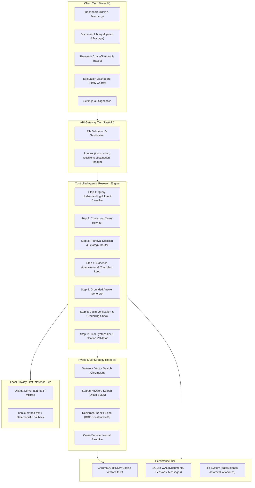

# NexusAI: Technical Architecture & System Design

## 1. Executive Architectural Overview

**NexusAI** is an advanced, production-grade Agentic Retrieval-Augmented Generation (RAG) platform designed for complex document investigation. Unlike simple "chat-with-PDF" wrappers that suffer from vector search myopia, hallucinated citations, and uncontrolled conversational drift, NexusAI employs a **deterministic hybrid retrieval engine** and a **controlled 7-step agentic finite state workflow**.



---

## 2. Ingestion & Preprocessing Subsystem

### 2.1 File Ingestion & Security Validation
- **Extension & MIME Validation:** Enforces `.pdf` format with strict byte signature checks.
- **Size Limits:** Enforces a configurable ceiling (default 25MB) preventing buffer overflow and memory exhaustion.
- **SHA-256 Deduplication:** Computes hash of raw document bytes to reject duplicate uploads before indexing, eliminating redundant vectors.
- **Scanned Document Detection:** Inspects extracted character count per page; flags rasterized or image-only documents and warns the user that OCR is required.

### 2.2 Text Normalization (`text_cleaner.py`)
- Removes non-printable ASCII control characters (`\x00-\x1f`).
- Recombines hyphenated word breaks at line ends (e.g. `trans-\nformer` -> `transformer`).
- Normalizes excess whitespace while preserving paragraph boundaries (`\n\n`).
- Heuristically detects tables (pipes and tab-delimited columns) and mathematical formulas.

### 2.3 Recursive Sliding-Window Chunking (`chunking.py`)
Splits text according to a prioritized hierarchy of separators:
`["\n\n", "\n", ". ", "? ", "! ", "; ", " ", ""]`

Every single chunk retains strict 1-indexed metadata:
```json
{
  "chunk_id": "doc_id_p3_c1",
  "document_id": "doc_id",
  "filename": "transformer_research.pdf",
  "page_number": 3,
  "chunk_index": 1,
  "char_count": 482,
  "token_estimate": 120,
  "has_tables": false,
  "has_equations": true
}
```
Metadata is preserved across vector and keyword indices so that citations are never dissociated from their physical page numbers.

---

## 3. Advanced Multi-Strategy Retrieval Engine

NexusAI implements four distinct retrieval strategies to balance semantic understanding with exact technical term precision.

### 3.1 Dense Semantic Retrieval (`semantic_search.py`)
- Uses `nomic-embed-text` (or deterministic normalized dense fallback).
- Calculates cosine distance over HNSW indexing graph in ChromaDB.
- Normalizes distance $d \in [0, 2]$ to similarity score:
  $$S_{\text{semantic}} = \max\left(0, 1 - \frac{d}{2}\right)$$

### 3.2 Sparse Lexical Retrieval (`keyword_search.py`)
- Employs the **Okapi BM25** probabilistic relevance framework:
  $$\text{Score}_{\text{BM25}}(D, Q) = \sum_{q \in Q} \text{IDF}(q) \cdot \frac{f(q, D) \cdot (k_1 + 1)}{f(q, D) + k_1 \cdot \left(1 - b + b \cdot \frac{|D|}{\text{avgdl}}\right)}$$
- Preserves technical phrases, acronyms, and symbols (e.g., `O(n log n)`, `Llama-3.2`, `torch.nn.Module`) that vector embeddings often collapse.

### 3.3 Reciprocal Rank Fusion (`hybrid_search.py`)
Fuses rankings from dense vector and sparse lexical retrieval without requiring brittle score calibration or threshold tuning:
$$\text{RRF\_Score}(d) = \sum_{m \in \{\text{semantic}, \text{keyword}\}} \frac{w_m}{k + r_m(d)}$$
where $k = 60$ is the standard smoothing constant, $r_m(d)$ is the 1-based rank of passage $d$, and $w_m = 1.0$.

### 3.4 Cross-Encoder Neural Reranking (`reranker.py`)
Unlike dual-encoder bi-encoders that encode query and document independently, the Cross-Encoder performs joint all-to-all self-attention:
$$\text{Score}_{\text{rerank}} = \text{CrossEncoder}([Q, D])$$
Passages retrieved from the hybrid candidate pool (e.g., top 10) are re-scored, promoting passages that have high semantic interaction with the query to top ranks.

---

## 4. Controlled 7-Step Agentic Workflow

Instead of unbounded autonomous loops that cause unexpected token costs and hallucinations, NexusAI executes a controlled stateful workflow with strict boundary ceilings:

```
[User Query]
     │
     ▼
[Step 1: Query Understanding] ──► (Conversational / Meta) ──► [Direct Answer]
     │ (Retrieval Required)
     ▼
[Step 2: Contextual Query Rewriting] (Resolves multi-turn pronouns)
     │
     ▼
[Step 3: Retrieval Decision & Search] (Semantic, BM25, Hybrid, Rerank)
     │
     ▼
[Step 4: Evidence Sufficiency Assessment]
     │
     ├──► Insufficient & Retries < MAX_RETRIES ──► [Query Expansion] ──► (Loop back to Step 3)
     │
     ▼ Sufficient
[Step 5: Grounded Answer Generation] (Injects verified context & citation schema)
     │
     ▼
[Step 6: Claim Verification] (Checks claims against retrieved text)
     │
     ▼
[Step 7: Final Synthesis & Citation Audit] (Rejects non-existent source references)
     │
     ▼
[Client Response with Citations & Step Telemetry]
```

---

## 5. RAG Evaluation Engine

NexusAI features an empirical Information Retrieval (IR) and Generation evaluation engine.

### Evaluation Metrics Implemented
1. **Precision@K:** $\frac{|\text{Relevant} \cap \text{Retrieved}_{\le K}|}{K}$
2. **Recall@K:** $\frac{|\text{Relevant} \cap \text{Retrieved}_{\le K}|}{|\text{Relevant}|}$
3. **Mean Reciprocal Rank (MRR):** $\frac{1}{|Q|} \sum_{i=1}^{|Q|} \frac{1}{\text{rank}_i}$
4. **Hit Rate@K:** $1.0$ if any relevant document is found in top $K$, else $0.0$.
5. **Faithfulness:** Proportion of answer statements supported by source context.
6. **Answer Relevance:** Topical semantic overlap between query and generated text.

---

## 6. Persistence & Security Design

- **SQLite WAL Mode:** Supports concurrent reads and single-writer safety for multi-turn chats and metadata records.
- **Privacy-First:** Operates 100% locally with Ollama and ChromaDB without external API data transmission.
- **Source Verification:** The answer generator scans every generated citation `[Doc: filename, Page X]` against the actual retrieved context, stripping any hallucinated source references.
